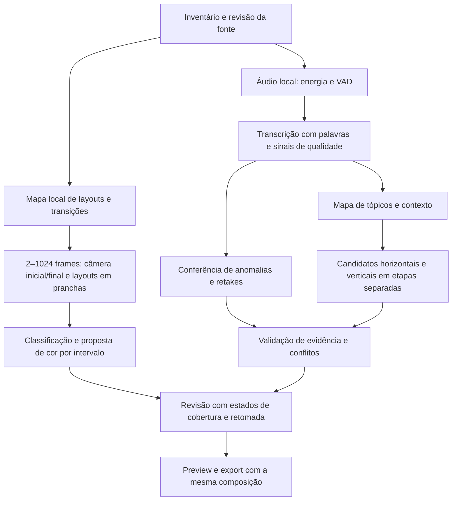

# Plano de melhoria da qualidade da análise

- Status: implementação parcial; execução integral Codex concluída em clone, revisão humana e corpus anotado pendentes.
- Revisão: 11; data: 2026-10-27.
- Histórico: [log](../revision-history.md#docsplanninganalysis-quality-planmd).
- Fontes: pedido do usuário em 2026-10-26; [diagnóstico, revisão 2](../engineering/analysis-quality-audit.md); [PRD, revisão 35](../product/prd.md); [jornadas, revisão 35](../product/user-journeys.md); [definição técnica, revisão 43](../engineering/technical-definition.md).
- Integração: extensão do [plano principal, revisão 48](implementation-plan.md), tarefas TASK-022–034. IDs anteriores preservados.
- Escopo autorizado pelo usuário: executar as tarefas do plano. Implementações foram feitas no app e documentadas abaixo; os critérios que exigem inspeção humana/multimodal permanecem abertos.

## Resultado esperado

Uma análise revisável que distingue trechos removíveis, problemas da transcrição e falhas do processamento; encontra unidades completas para YouTube; detecta silêncio no áudio; e avalia a imagem da câmera separadamente dos slides. Fonte e revisão humana permanecem protegidas.

Manter processamento local de vídeo/áudio, Whisper selecionado pelo usuário, provedor selecionável globalmente: OpenCode com `opencode/mimo-v2.6-flash-free` ou Codex CLI com `gpt-6-luna` e esforço `medium`, amostrar 2–1024 frames por execução (padrão 8, quantidade selecionável globalmente), agrupá-los em pranchas de até 128 frames rotulados com índice e timestamp, enviar até oito pranchas por chamada e manter toggle, revisão antes de aplicar edições/cores e upload privado já existente. Não introduzir compra ou contratação automática, envio externo de áudio/vídeo, serviço distribuído, fine-tuning ou publicação automática. Não depende do piloto OAuth.

## Processo proposto

As ramificações são independências lógicas; não autorizam chamadas externas simultâneas sem limite. Começar sequencialmente no provedor selecionado, guardar resultado de cada unidade e limitar tentativas. Reter contexto global por resumo de tópicos e referências aos segmentos originais; não fragmentar às cegas por duração.

## Contratos transversais propostos

1. **Execução versionada:** `analysis_run_id`, revisão/hash da fonte e transcrição, versões de configuração/prompts, provedor/modelo/esforço efetivos e artefatos por etapa. Não registrar credenciais, stderr bruto ou respostas irrestritas do CLI. JSON aditivo compatível com projetos existentes.
2. **Estado por capacidade:** `pending/running/complete/partial/failed/skipped/stale`, motivo tipado, duração, tentativas, quantidade recebida/validada/rejeitada. `complete` com zero itens exige justificativa de ausência; erro não vira sucesso vazio. Revisão parcial permanece acessível com aviso persistente.
3. **Sugestão rastreável:** ID estável, tipo, intervalo da fonte, segmentos/palavras de apoio, citação, motivos a favor/contra, origem, versão e decisão humana. “Confiança” autorrelatada do modelo não é probabilidade calibrada.
4. **Idempotência e retomada:** salvar por etapa/unidade e refazer só a falha. Alterar transcrição invalida semântica/traduções dependentes, sem apagar decisões anteriores; resultados ficam `stale` e a substituição é explícita. Alterar edição não retranscreve. Workers verificam geração ativa antes de gravar; concorrência por projeto serializada.
5. **Conflitos:** proposta pendente de remoção sinaliza conflito no corte e permite revisão conjunta; rejeitada não bloqueia. Remoção aceita é subtraída no render e nas legendas. Revalidar a integridade semântica do corte após remoção interna; se quebrar contexto, impedir aprovação do candidato até ajuste/rejeição do conflito. Não descartar todos os candidatos silenciosamente.
6. **Cor por intervalo:** `scene_segments[]` com limites na fonte, `camera/slides/screen/mixed/unknown`, evidência/confiança, métricas, política e proposta; aprovação/intensidade por segmento. `mixed/unknown` preservam. Falha externa preserva os segmentos sem classificação confirmada, permite anotação manual local e retomada. Nenhum desbloqueio por simples falta de slides detectados.

## Fase 1 — Recuperação e sugestões conservadoras

Entrega: o projeto problemático pode ser revisto com falhas explícitas, silêncio final medido e sem transformar duplicação de ASR/enumeração em remoção. Critério de saída: TASK-022–025 e TASK-031/032 verificadas num clone isolado; as demais capacidades continuam com estado honesto até a fase seguinte.

### TASK-022 — Fixar baseline e casos de regressão

- Fontes: REQ-002/006/010/011/012; JRN-001; DEC-024; BDD-JRN-001-17/18/19/20.
- Dependências: nenhuma. Primeira tarefa executável.
- Entradas/DoR: diagnóstico, JSON atual da API, fonte legível; localizar armazenamento com `app/state.py`, sem copiar segredos.
- Subtarefas: criar fixture mínima desidentificada e snapshot local protegido do resultado; preparar clone sem uploads; selecionar janelas de 84–97, 145–156, 674–686 e 970–985,45 s; ouvir e anotar fala, retakes, pausas e limites; inspecionar transições câmera/slides. Registrar divergências e anotações ainda pendentes.
- Escolhas permitidas: usar fixtures sintéticas para cenários e amostras reais somente localmente; não versionar vídeo/transcrição integral ou logs privados.
- Validação: carregar snapshot sem alterar original; reproduzir cinco candidatos e ausência de horizontal/final; adicionar testes de regressão que falham pelo motivo identificado, usando `unittest` existente.
- DoD/evidência: manifesto com intervalos, rótulos e origem humana/técnica; hash da fonte antes/depois; casos positivos de retake real e negativos de enumeração/pausa; snapshot reversível. Baseline editorial não vira “ground truth” apenas pela previsão antiga.
- Resultado: defeitos reproduzíveis e comparação antes/depois por caso; taxas gerais ainda não afirmadas.
- Documentação: diagnóstico e relatório de validação ligado a este plano.
- Parar se: fonte inacessível ou rótulo impossível de decidir pelo áudio; registrar caso como inconclusivo, prosseguir com casos inequívocos e solicitar revisão apenas do conjunto ambíguo antes de fechar qualidade editorial.

### TASK-023 — Tornar etapas observáveis e recuperáveis

- Fontes: REQ-006/009/012; JRN-001; DEC-024; BDD-JRN-001-17/21.
- Dependências: TASK-022.
- Entradas/DoR: `main._analysis_job`, `state.py`, `opencode_runner.py`, renderização de progresso em `app/static/app.js`; fixture de execução antiga.
- Subtarefas: implementar estado por capacidade/geração; checkpoints atômicos; erro tipado para timeout, CLI, resposta vazia, JSON/schema, validação; mapear `subprocess.TimeoutExpired`; remover ambiguidade das constantes 180/240 s; endpoint/ação para retomar capacidade sem retranscrever; contadores de descartes; preservar revisão anterior.
- Política inicial proposta: no máximo uma repetição automática para falha transitória; JSON inválido admite uma tentativa corretiva dentro do mesmo teto. Erro de configuração não repete. Orçamento total configurável e visível, definido após medir TASK-022; não multiplicar timeout por quantidade de chunks sem teto.
- Validação: testes com runner falso para timeout, schema ausente, zero legítimo, sucesso parcial, interrupção/reinício, duas gerações e duplo clique. Backend e UI devem concordar sobre capacidade incompleta.
- DoD/evidência: retomada preserva hash da transcrição, decisões, traduções e resultados válidos; gravação velha não sobrescreve geração nova; nenhum dado sensível em erro; legado continua abrindo.
- Resultado: falha nunca equivale a ausência legítima e retry é limitado.
- Documentação: REQ-012, DEC-024, how-to-review (aviso/retomada), referência dos estados quando implementada.
- Parar se: houver risco de sobrescrever revisão atual; manter snapshot e resolver migração antes de oferecer retomada no projeto original.

### TASK-024 — Detectar silêncio a partir do áudio

- Fontes: REQ-002/012; JRN-001; DEC-025; BDD-JRN-001-18.
- Dependências: TASK-022/023.
- Entradas/DoR: FFmpeg do container, áudio original e janelas anotadas; VAD já integrado pelo faster-whisper.
- Subtarefas: persistir intervalos de fala/VAD e energia; separar política de início, pausas internas e cauda; cruzar com palavras quando disponíveis; usar piso de ruído local e margem depois da última palavra; tratar silêncio ao EOF sem depender de `silence_end`; evitar corte em fala baixa, respiração útil, música/outro intencional.
- Parâmetros: −35 dB e margem antiga 0,35 s são referências de experimento, não limiares universais. Escolher conservadoramente comparando fala baixa, ruído e cauda no corpus; persistir configuração efetiva e medição. Não cortar automaticamente após a expressão “muito obrigado”.
- Validação: cauda real abaixo de 3 s, EOF, sem silêncio, voz baixa, ruído constante, música, pausa retórica e arquivo sem fala. Ouvir preview da última frase.
- DoD/evidência: sugerir cauda final deste caso mantendo “muito obrigado gente” inteiro; intervalo limitado à mídia e apoiado por áudio; nenhuma remoção aplicada sem aceitar.
- Resultado: detecção independente de gaps do ASR e do provedor externo.
- Documentação: REQ-002, DEC-025, how-to-review e referência dos parâmetros efetivos.
- Parar se: áudio e VAD divergirem sobre fala final; sinalizar incerteza e exigir revisão, sem remover por regra.

### TASK-025 — Validar transcrição e retakes antes de sugerir remoção

- Fontes: REQ-002/006/012; JRN-001; DEC-025; BDD-JRN-001-19/20.
- Dependências: TASK-022/023; integrar áudio de TASK-024.
- Entradas/DoR: segmentos, áudio local, fixtures de duplicação e retake legítimo; opções instaladas do faster-whisper.
- Subtarefas: habilitar/persistir palavras e probabilidade quando disponíveis, `avg_logprob`, `no_speech_prob` e `compression_ratio`; detectar fala textual impossível para duração, sobreposição e repetição comprimida; marcar `transcript-anomaly` separada de edição; retranscrever somente janela suspeita com contexto local e mapear offset; preservar texto corrigido pelo usuário.
- Retakes: semelhança textual apenas gera hipótese interna; promoção exige evidência de reinício/correção e alinhamento no áudio, com contexto anterior/posterior. Proteger enumerações com entidades diferentes, exemplos e ênfase. Dúvida vira item para conferir transcrição, não sugestão de apagar vídeo. Não apagar áudio para “corrigir” texto duplicado.
- Evidência semântica: remoção comum exige citação no alvo; intenção editorial explícita admite citação externa vinculada ao segmento da solicitação e ao alvo, com cálculo verificável de referência relativa. Validar números finitos e limites; não elevar confiança só porque duas regras concordaram.
- Complemento BDD-JRN-001-26: localizar comentário editorial próximo por alinhamento único de palavras, propor sua remoção separadamente ou completar o intervalo sobreposto; preservar a retomada, texto corrigido e decisões humanas. Caso real: projeto `[id de projeto local]`, comentário 79,32–82,28 s.
- Complemento BDD-JRN-001-27: detectar e mostrar colapso de timestamps de palavras e bloquear novas remoções que dependam desses segmentos. No projeto `[id de projeto local]`, s74/s75 têm respectivamente 6/10 e 10/11 palavras com duração zero; nova inferência local de 483–511 s, tanto com large-v3 quanto medium sem contexto prévio, não reproduziu a repetição. Ainda é necessária conferência humana do áudio e avaliação em outros vídeos antes de trocar o modelo ou a configuração padrão.
- BDD-JRN-001-28: lacunas no ASR não criam cortes de silêncio, e silêncio final nunca começa antes da medição do áudio; falhas semânticas aparecem como análise parcial. A UI distingue erros e anomalias e marca também sugestões antigas baseadas em evidência problemática.
- Citações comuns são verificadas em palavras no intervalo proposto (mínimo três palavras e metade da citação); se não houver alinhamento compatível, somente segmentos completos contidos no intervalo servem como evidência. A regra editorial explícita continua separada.
- BDD-JRN-001-29: na inicialização do servidor único, trabalhos órfãos são sinalizados, com revisão preservada e envio incerto protegido; a exportação não descarta subdivisões curtas de cena e requer câmera revisável para aplicar cor.
- Transcrição vazia marca análise textual indisponível em vez de chamar o provedor com conteúdo vazio; o progresso do Whisper mostra a posição no áudio para execuções novas, sem estimar tempo restante.
- Validação: casos 88–92 s e 150–152 s, enumeração C/R, retake real, hesitação, citação distante sem pedido, pedido editorial válido e injeção de prompt.
- DoD/evidência: enumeração não aparece como removível; artefato ASR não produz corte destrutivo; retake positivo segue detectável; todos os itens promovidos têm evidência no alvo ou exceção editorial explícita.
- Resultado: reduzir falsos positivos demonstrados sem resolver tudo suprimindo candidatos.
- Documentação: REQ-002, DEC-025, how-to-review (transcrição versus edição).
- Parar se: correção proposta sobrescrever texto humano ou pedir provedor/modelo fora das duas opções autorizadas; preservar versão e manter revisão explícita.

## Fase 2 — Cortes úteis e cor por trecho

Entrega: temas horizontais completos e câmera inicial/final avaliada independentemente dos slides, com aprovação e export coerentes. Saída: TASK-026–030 verificadas ponta a ponta. Não prometer quantidade fixa de cortes ou ganho percentual sem baseline.

### TASK-026 — Gerar cortes por tópicos com contexto e validação independente

- Fontes: REQ-003/010/012; JRN-001; DEC-026; BDD-JRN-001-21/22.
- Dependências: TASK-023/025/031; usar mapa local de TASK-027 quando disponível, sem depender dele para cortes textuais.
- Entradas/DoR: transcrição vigente e tópicos anotados; funções atuais de prompt/parser/merge/export.
- Subtarefas: separar mapa global de tópicos, candidatos horizontais, shorts e remoções; usar IDs de segmentos para limites e citações. Para transcrições grandes, janelas por orçamento de contexto com sobreposição, resumo global e expansão de bordas até completar argumento; resolver IDs em tempos localmente. Cache por unidade/versão permite retomar somente falhas.
- Avaliação: candidato explicita tema, promessa, contexto necessário, conclusão e evidência; verificador procura início dependente do trecho anterior, pronome sem referente, exemplo incompleto, ressalva ausente e encerramento abrupto. Segundo passe do mesmo modelo auxilia, mas não conta como confirmação independente do áudio/revisor.
- Contratos: `youtube_cuts` obrigatório no schema de horizontais; ausência é erro, vazio com motivo é resultado possível. Registrar `generated/invalid/conflicted/retained` e motivos. Tratar conflitos conforme contrato transversal; não filtrar todos por edição pendente.
- Fallback: se o provedor falhar, expor tópicos/intervalos locais como rascunho não validado, quando houver evidência suficiente; não promover janelas por densidade de palavras a cortes “prontos”. Candidatos manuais continuam possíveis. Não inventar horizontais só para preencher lista.
- Validação: tema atravessando janelas; tópico que requer introdução longa; modelo retorna campo ausente; remoção falsa pendente/rejeitada/aceita; timeout em só uma unidade; corte sem candidato legítimo; idioma da fonte; export e legendas em tempo relativo.
- DoD/evidência: no clone, retornar ao menos uma unidade completa **se** confirmada pela anotação, com título/introdução/conclusão e preview; caso contrário justificar sem fingir sucesso. Falha em shorts não elimina horizontais. Shorts mantêm contrato 30–60 s e formato separado.
- Resultado: cortes escolhidos por unidade de ideia, com recuperação e explicação de ausências.
- Documentação: REQ-002/003/010, DEC-013/026, BDD-001-11/22 e how-to-review.
- Parar se: contexto integral exigir envio de vídeo/áudio ou modelo fora das opções autorizadas; reportar limitação e manter candidato manual/local.

### TASK-027 — Construir mapa de câmera, slides e transições

- Fontes: REQ-011/012; JRN-001; DEC-027; BDD-JRN-001-23.
- Dependências: TASK-023/031; usar anotações de TASK-022.
- Entradas/DoR: `visual.analyze_video`, `mimo_vision.select_sample_times/review_scenes`, fonte e limite global configurável de 2–1024 frames por execução (padrão 8).
- Subtarefas: localizar transições com FFmpeg/OpenCV e refinar fronteiras; separar troca de slide de troca de layout; construir intervalos contínuos `camera/slides/screen/mixed/unknown`. Priorizar frames internos representativos da abertura e encerramento, layouts distintos e lados relevantes das transições, evitando timestamp EOF, transição e duplicatas.
- Multimodal: responder por frame/segmento, não booleano global; associar IDs, tempos, motivo e confiança; no máximo o limite configurado de 2–1024 frames fonte amostrados por execução, incluindo retry. Agrupar em imagens de até 128 quadros, com índice global e timestamp acima de cada tile, e limitar cada chamada a oito imagens compostas. Toggle desligado envia zero imagens e mantém mapeamento local/manual.
- Limite de inferência: frame classificado não prova todo o intervalo; propagar somente em trecho localmente homogêneo; intervalo insuficientemente coberto fica desconhecido. Preservar mistos/slide/unknown; permitir anotação manual de câmera com preview e decisão explícita.
- Validação: câmera→slides→câmera; só câmera; só slides; webcam pequena; muitas trocas; transição gradual; frame ilegível; toggle off; resposta inválida. Incluir amostras 5/35/90/490/955/980 s e conferir limites reais.
- DoD/evidência: mapa cobre a duração sem lacunas/sobreposições inválidas; câmera inicial/final não é substituída pelo rótulo dos slides; total externo auditável <=8; falha parcial afeta apenas intervalos incertos.
- Resultado: evidência visual localizada, com cobertura explícita.
- Documentação: REQ-011, DEC-015/016/017/027 e explicação da análise visual quando entregue.
- Parar se: ampliar quota, transmitir fonte ou instalar nova dependência exigir alteração material de escopo; preferir stack atual e marcar cobertura insuficiente.

### TASK-028 — Propor e revisar ajuste de cor por segmento

- Fontes: REQ-011; JRN-001; DEC-027/028; BDD-JRN-001-23/24.
- Dependências: TASK-027.
- Entradas/DoR: mapa, metadados BT.709/faixa da fonte e amostras de câmera; contratos atuais de preview e revisão.
- Subtarefas: métricas temporais por segmento/ROI relevante da câmera, separando rosto/fundo quando confiável; medir luma, clipping e saturação; propor ajuste limitado de exposição/contraste/saturação apenas com evidência. Abrir item de avaliação para câmera inicial/final mesmo quando a conclusão for neutra. Não usar saturação baixa de slide como evidência para pele.
- Escopo de cor: preservar tags/faixa; não converter HDR implicitamente; não inferir balanço de branco correto sem referência. Balanço de branco automático e correção de iluminação localizada ficam fora desta entrega; uma necessidade comprovada ganha proposta própria.
- UI: antes/depois por segmento e entorno da transição; motivo, intensidade e aceitar/rejeitar; slides/mixed/unknown preservados. Falha de visão pode ser resolvida por classificação manual explícita, sem liberar globalmente o vídeo.
- Validação: câmera subexposta, câmera sem ajuste necessário, pele/fundo com cores intencionais, slides claros/escuros, falha em uma cena e mudança de intensidade; verificar persistência.
- DoD/evidência: abertura e final deste caso recebem avaliação própria e proposta justificada ou motivo de neutralidade; slides não recebem grade. Ajustes não aumentam clipping de modo injustificado nas amostras e aprovação é individual.
- Resultado: sugestão localizada, sem obrigação de inventar alteração para imagem já adequada.
- Documentação: REQ-011, DEC-028, how-to-review e referência dos controles.
- Parar se: fonte tiver metadados incompatíveis com caminho suportado ou proposta demandar LUT/HDR/novo espaço de cor; preservar e registrar necessidade.

### TASK-029 — Unificar preview, export e timeline de cor

- Fontes: REQ-004/006/010/011; JRN-001; DEC-028; BDD-JRN-001-11/24.
- Dependências: TASK-024/026/028.
- Entradas/DoR: decisões aprovadas, funções de intervalos/legendas, `media.render_video` e `visual.preview_contact_sheet`.
- Subtarefas: gerar composição canônica em tempo da fonte com interseção entre cenas, corte selecionado e intervalos mantidos; aplicar parâmetros aprovados antes de concatenar, ou mapear explicitamente os tempos; compartilhar transformação FFmpeg com preview. Evitar saltos artificiais de grade dentro de uma mesma cena; em trocas de layout não espalhar interpolação para slides. Renderizar master, horizontal e vertical com a mesma política de cor.
- Compatibilidade: projetos antigos continuam abrindo; configuração global antiga só é convertida para segmentos seguros com decisão explícita, nunca para liberar slides. Preservar tracking/crop, idioma, títulos e decisões já salvas.
- Validação: corte começando no meio de câmera, remoção antes da cena, remoção atravessando cena, múltiplas cenas, ajustes rejeitados e export de todas as variantes; verificar último fonema no áudio e alinhamento das legendas. Comparar frames decodificados de preview/export com tolerância documentada ao encoder, não igualdade de bytes comprimidos.
- DoD/evidência: tempos/duração/dimensões corretos por ffprobe; legendas correspondem à timeline retida; grade restrita a interseções aprovadas; frames antes/depois de cada fronteira inspecionados e slides comparados a render neutro equivalente.
- Resultado: o usuário recebe no arquivo a composição que aprovou.
- Documentação: DEC-028, how-to-review e evidência de qualidade por ativo.
- Parar se: inconsistência entre preview/render não puder ser resolvida; bloquear export afetado, preservar fonte e demais resultados.

### TASK-030 — Revisar ponta a ponta e publicar relatório de qualidade

- Execução integral: clone `[id de projeto local]` concluiu as quatro capacidades com Whisper large-v3, Codex GPT-6 Luna Medium e 128 frames. Evidências, resultados e limitações: [relatório de validação](../engineering/analysis-reliability-validation.md). A inspeção editorial humana e o corpus anotado ainda não foram feitos.

- Fontes: todos os REQ/JRN/DEC deste plano; BDD-JRN-001-17–24 e regressões existentes.
- Dependências: TASK-022–029 e TASK-031/032.
- Entradas/DoR: clone isolado, casos anotados e todas as etapas persistidas; aplicação local atualizada somente no passo de implementação autorizado.
- Subtarefas: reanalisar clone com a mesma fonte/large-v3; comparar OpenCode e Codex selecionados explicitamente em execuções separadas; exercitar falhas injetadas e retomada, correção de transcrição, revisão de conflitos, seleção de cortes e grade, export master/horizontal/vertical e SRT/VTT. Validar desktop/mobile, reload e legado, sem upload; verificar que texto e imagens usam exclusivamente o provedor registrado em cada execução e que alternar configuração não altera uma execução ativa.
- Validação: comandos existentes: `uv run --extra test python -m unittest discover -s tests`; `uv run python -m compileall -q app`; `node --check app/static/app.js`. Inspecionar `package.json`/config e adaptar Playwright existente aos novos fluxos; não supor que os testes atuais cobrem qualidade audiovisual.
- Métricas: precisão/recall de remoções só nos intervalos anotados, separados por tipo e com contagens/denominador; erros de fronteira contra anotação; candidatos horizontais completos aceitos/rejeitados e motivo; cobertura de layout/desconhecidos; trechos de slide indevidamente corrigidos; tempo por etapa, retries e completude. Tempo de revisão é medido no piloto, sem meta inventada.
- DoD/evidência: falsos positivos identificados eliminados sem perder retake positivo; cauda final sugerida com última frase preservada; horizontal completo validado quando sustentado por conteúdo; avaliação de cor inicial/final independente e slides preservados; falha aparece como parcial e retoma sem perder revisão. Revisão humana da qualidade editorial e visual registrada, nunca substituída por testes mockados.
- Resultado: relatório antes/depois por caso, limitações restantes e decisão de liberação. Medições de um vídeo não representam taxa geral do produto.
- Documentação: atualizar diagnóstico, relatório, PRD/jornadas/decisões/plano/estado/log e mapa Diátaxis; manter README/CONTRIBUTING e `.gitignore` adequados aos comandos/fixtures; AGENTS só muda se caminhos/comandos/regras duráveis mudarem. Nenhum novo subprojeto previsto.
- Parar se: alguma regressão bloquear os quatro objetivos; entregar evidência e manter liberação pendente. Não alterar projeto original nem publicar sem ação autorizada correspondente.

## Seleção global de IA — extensão solicitada pelo usuário

Confirmado em 2026-10-26: oferecer nas configurações a opção **Codex · GPT-6 Luna · Medium** em vez de OpenCode para executar as análises. Preservar as duas opções, com seleção explícita global; OpenCode permanece padrão de migração para instalações atuais. A seleção cobre análise textual e revisão de imagens; Whisper, VAD, métricas visuais e tradução continuam locais.

### TASK-031 — Adicionar executor Codex e contrato comum de provedores

- Fontes: REQ-009/012, JRN-005, DEC-029, BDD-JRN-005-01/02/03; pedido do usuário em 2026-10-26.
- Dependências: TASK-023; pode avançar antes de TASK-024/025/027.
- Entradas/DoR: `opencode_runner.py`, `ai_analysis.py`, `mimo_vision.py`, Dockerfile/Compose e CLI instalado. Inspeção local confirmou `codex exec` com `--model`, `--image`, `--output-schema`, `--json`, `--ephemeral` e `--ignore-user-config`; catálogo local confirmou `gpt-6-luna`, `medium`, texto e imagem. Isso não comprova acesso/autenticação no container.
- Subtarefas: extrair interface comum de execução/saúde/capacidades/erro; adaptar OpenCode sem regressão; adicionar Codex com modelo exato `gpt-6-luna` e `model_reasoning_effort="medium"`, ambos passados explicitamente. Usar stdin para prompt, saída estruturada e parser específico de eventos Codex; nunca assumir JSONL igual ao OpenCode. Encaminhar texto e imagens ao mesmo provedor do snapshot da execução.
- Ambiente: disponibilizar binário e autenticação Codex ao serviço local com configuração mínima; não montar todo o perfil pessoal nem reusar config, MCP/apps, hooks, plugins, instruções de projeto ou sessões desta conversa. Executar em diretório temporário isolado, modo somente leitura, sem ferramentas de shell/rede externas ao pedido do modelo; conferir controles da versão instalada. Se não houver isolamento suficiente, bloquear integração até resolvê-lo, sem usar bypass de permissões. Tratar refresh de credencial conforme mecanismo suportado, sem prometer que arquivo somente leitura basta.
- Política: sem fallback automático entre provedores; sem seleção automática de outro modelo ou alteração de esforço; provider indisponível segue fluxo parcial/retry do plano. Consumo segue conta Codex configurada, sem aquisição automática de créditos/plano. Preservar toggle e orçamento total de frames escolhido, sem envio de áudio/vídeo integral.
- Validação: runners falsos para argumentos, stdin, anexos, JSON/schema, timeout e autenticação; integração controlada no container com transcrição mínima e JPEG sintético quando a implementação for autorizada, sem copiar credenciais para fixtures/logs. Conferir que modelo/esforço efetivos correspondem à solicitação; não alegar sucesso somente por binário existir.
- DoD/evidência: texto e imagem funcionam pelo Codex selecionado; erros são seguros e tipados; OpenCode continua funcionando; health distingue binário, autenticação, acesso ao modelo e capacidade; metadados registram provedor/modelo/esforço; nenhum tool call indesejado ou vazamento de contexto pessoal.
- Resultado: mesmo pipeline de validação para os dois executores, com semântica de falha consistente.
- Documentação: REQ-009, DEC-029, README/CONTRIBUTING quando setup mudar, how-to-run e referência de provedores após entrega.
- Parar se: modelo não disponível à conta, autenticação não suportada no serviço ou isolamento insuficiente; mostrar impedimento exato e permitir escolha explícita de OpenCode, sem substituição silenciosa.

### TASK-032 — Selecionar e persistir provedor nas configurações

- Fontes: REQ-006/009/012, JRN-005, DEC-029, BDD-JRN-005-01/02/03.
- Dependências: TASK-031.
- Entradas/DoR: página `/settings`, `GET /api/settings/ai`, armazenamento local de settings e contrato comum da TASK-031.
- Subtarefas: seletor global com **OpenCode · MiMo V2.6 Flash Free** e **Codex · GPT-6 Luna · Medium**; status/diagnóstico de disponibilidade por opção; salvar via endpoint validado e persistência atômica. Campos de modelo/esforço são fixos por opção nesta entrega. Exibir destino do texto e dos frames antes de iniciar; não expor credenciais na API.
- Execução: congelar provider/model/effort no início; alteração global vale para novas execuções. Retomada usa snapshot original; mudar provedor exige nova execução explícita, preservando resultados/revisões anteriores e invalidando dependentes conforme versão. Projetos legados mantêm proveniência OpenCode, sem reescrever histórico. Codex selecionado dispensa OpenCode autenticado; disponibilidade é verificada apenas para o executor escolhido.
- Validação: persistência após reload/restart; escolha Codex sem OpenCode e vice-versa; opção inválida; provedor indisponível; mudança durante execução; retomada com configuração global diferente; legado sem campo de provedor; toggle off sem imagens; falha sem fallback implícito. Playwright desktop/mobile e testes de settings seguem ferramentas atuais.
- DoD/evidência: configuração salva governa toda nova análise textual/visual; UI e backend concordam; resultados mostram proveniência; análise ativa/decisões antigas preservadas. TASK-030 exercita os dois provedores separadamente no mesmo corpus quando ambos disponíveis.
- Resultado: usuário escolhe Codex Luna Medium no lugar do OpenCode sem depender de editar arquivos ou variáveis manualmente.
- Documentação: how-to-review/how-to-run, REQ-009, JRN-005 e referência dos estados/opções quando implementados.
- Parar se: credencial/modelo da opção escolhida não estiver operacional; salvar preferência com estado indisponível e impedir início generativo com orientação acionável, sem trocar de opção.

## Dependências e priorização

`022 → 023 → 024/025`; `023 → 031 → 032`; `025 + 031 → 026`; `023 + 031 → 027 → 028`; `024 + 026 + 028 → 029`; `029 + 032 → 030`.

TASK-025 pode começar com fixtures da TASK-022, mas só fecha integrada ao áudio de TASK-024. TASK-027 pode avançar após TASK-023; não exige esperar cortes. Não há estimativa de dias: capacidade e duração de processamento ainda não foram medidas. Cada fase tem uma entrega revisável, sem depender de OAuth.

## Cobertura e decisões

| Necessidade | Execução | Condição de aceite |
|---|---|---|
| Reduzir falsos positivos, REQ-002 | 022, 024, 025, 030 | Enumeração e anomalia ASR preservam vídeo; retake confirmado segue detectado |
| Cortes YouTube, REQ-010 | 023, 026, 029, 030 | Contexto completo e ausência/falha distinguíveis |
| Silêncio final, REQ-002 | 022, 024, 029, 030 | Cauda deste caso detectada sem cortar fala |
| Cor inicial/final, REQ-011 | 027–030 | Câmera avaliada por trecho e slides preservados |
| Retomada e confiança, REQ-006/012 | 023 e integração de todas | Sem sucesso falso, perda de revisão ou duplicação de geração |
| Verticais/legendas/exports existentes | 026, 029, 030 | Formatos, idiomas, intervalos e revisão continuam funcionando |
| Seleção OpenCode/Codex, REQ-009 | 031, 032, 030 | Preferência global persistida; Codex `gpt-6-luna`/`medium` para texto e imagem; proveniência por execução |
| Upload REQ-005 e demais requisitos existentes | Plano principal preservado | Nenhuma expansão; piloto OAuth continua separado |

Confirmado pelo usuário: os quatro problemas e pedido de melhoria substancial com plano. Propostos: contratos, onze tarefas, decomposição da IA e políticas por segmento. Não há autorização registrada para implementação nesta sessão. A escolha OpenCode/Codex foi solicitada; não há ampliação de tipos/quantidade de mídia externa nem compra automática. Limiar de energia, margem, orçamento de chamadas e janela serão selecionados por experimento local com critérios acima; são escolhas técnicas reversíveis registradas, sem promessa de precisão universal. Casos editoriais inconclusivos exigem revisão humana antes de fechar a avaliação.

Próximo passo recomendado: `/mvp` desta extensão, começando em TASK-022. O pedido atual termina na proposta e no plano.

### Fontes e limites da integração Codex

Inspeção somente leitura em 2026-10-26: `codex exec --help` e campos não sensíveis do catálogo local `models_cache.json`. A [documentação oficial de modelos](https://learn.chatgpt.com/docs/models) descreve seleção no Codex; a [referência de configuração](https://learn.chatgpt.com/docs/config-file/config-reference) documenta `model_reasoning_effort`. O ID exato e modalidades foram conferidos no catálogo local. Nenhuma chamada ao modelo ou teste de credencial/container foi feito no planejamento; disponibilidade na conta será validada em TASK-031.

## Execução e evidência — linha de base histórica (revisão 3)

Implementação nos arquivos existentes; não alterou os dados nem o vídeo do projeto de referência. O diretório original permanece fonte somente de leitura para esta entrega; não foi criada uma análise nova, clone ou chamada real a Codex.

| Tarefa | Resultado da implementação | Verificação / pendência |
|---|---|---|
| TASK-022 | Fixtures sintéticas e regressões para enumeração paralela, cauda final e contrato de resposta horizontal. | Baseline anotado por pessoa e hash antes/depois do vídeo real não foram produzidos. |
| TASK-023 | Estado por geração/capacidade e retry manual de semântica, áudio ou visão; erros preservam resultados anteriores e decisões sobre intervalos compatíveis. | Não há retry automático limitado, contagem de descartes nem teste real de recuperação de processo; manter esta tarefa parcial. |
| TASK-024 | FFmpeg `silencedetect` alimenta sugestões de silêncio interno/final e grava intervalos/limiares no projeto. Medição somente de leitura no projeto original encontrou intervalo 982.524–985.429 s (2,905 s), com fim da última fala transcrita em 982.82 s; o candidato começa 982.92 s e termina em 985.45 s, preservando a fala e margem. | Limiar −35 dB/1,2 s é inicial, sem avaliação auditiva no caso original; abrir/fim de arquivo e fala baixa precisam ser revisados no clone. |
| TASK-025 | Palavras e sinais ASR persistidos; heurística de retake por similaridade removida; citação validada no intervalo; anomalias sinalizadas. | Clone atual sinalizou duas anomalias, inclusive o alvo ~501 s, e não sugeriu o falso corte. Conferir o áudio e retake segue pendente. |
| TASK-026 | Contrato exige `youtube_cuts`; conflitos ficam visíveis e a API bloqueia aprovação enquanto edição estiver pendente/aceita. | Saída real gerou 9 horizontais e 5 verticais; contexto, começo/fim e cortes aguardam revisão humana. |
| TASK-027 | Saída por frame/intervalo camera/slides/screen/mixed/unknown; cobertura ausente permanece unknown e respeita limite da TASK-033. | Clone usou 128/128 frames; classificou slides com inset, 127 lacunas somando 11,9% unknown. Início/fim foram rotulados slides na amostragem; inspeção humana pendente. |
| TASK-028 | Métricas e sugestões por intervalo; somente câmera segura habilita prévia, intensidade e aprovação; UI resume cobertura. | Nesta execução nenhuma faixa foi confirmada como câmera e não houve correção; não declarar avaliação de cor concluída para câmeras não vistas. |
| TASK-029 | Export divide timeline nas fronteiras de cor e aplica ajuste apenas em interseções aprovadas; prévia localizada por cena. Teste sintético cobre fronteira curta; render real de 10 s horizontal confirmou 1920×1080 e 10,0 s por FFprobe. | Não foi renderizado o vídeo integral nem comparado por pessoa preview/export. |
| TASK-030 | Execução integral em clone e relatório concluídos; UI automatizada validada. | Revisão humana, referência anotada, export integral e métricas de precisão/recall continuam pendentes; não inferir qualidade geral. |
| TASK-031 | Adapter Codex isolado, modelo/esforço explícitos, parser JSONL, schema e auth temporária; execução real de texto e imagem passou no container. | Um run validou integração; estabilidade/disponibilidade em outras execuções e qualidade editorial continuam sem amostra suficiente. |
| TASK-032 | Seletor global OpenCode/Codex, estado de disponibilidade e persistência atômica; snapshot por projeto. | Teste Playwright do seletor passou em desktop/mobile; API local confirma ambas opções. Troca durante análise ativa segue pendente. |
| TASK-035 | Passe focado baseado em IDs de palavras, remoção completa com evidência de tentativa/comentário/retomada, aviso de ambiguidade e UI em cartão único. | Reanálise semântica integral num clone real com Codex GPT-6 Luna Medium concluiu; corte 147,28–156,04 s e retomada completa mostrada. 66 testes unitários e 12 verificações Playwright passaram no total. Qualidade geral permanece limitada ao caso conhecido. |

Verificações sintéticas executadas: `PYTHONPATH=. uv run pytest tests -q --tb=short` (26 passaram); `uv run python -m compileall -q app`; `node --check app/static/app.js`; Playwright para provedor e cenas (4 execuções desktop/mobile). Container em `30100` reiniciado, health/API conferidas. Medição FFmpeg do silêncio e duas transições no original feita em leitura somente. `pytest` sem caminho de testes tentou coletar arquivos sob `models/cache` sem permissão; executar `pytest tests` evita esse diretório. Uma alternativa de transição a 1 fps foi rejeitada: produziu 13 limites contra dois na busca full-rate e levou tempo semelhante; o comportamento original foi restaurado. Chamadas de modelos reais foram deliberadamente omitidas; a suíte não demonstra qualidade editorial, autenticação Codex, comportamento do modelo ou equivalência visual de render.

### TASK-033 — Tornar configurável o limite de frames visuais

- Fontes: REQ-011, JRN-001, BDD-JRN-001-25, DEC-027/031; pedido do usuário em 2026-10-26.
- Dependências: TASK-027/031/032.
- Entrega: configuração global persistente de 2–1024 frames por análise, padrão 8; snapshot por projeto; amostragem respeita o total, compõe pranchas de até 128 tiles com índice/timestamp acima de cada frame e envia até oito imagens por chamada; retomada desconta frames já enviados/tentados; toggle desligado envia zero imagens.
- Verificação estática/operacional: API valida faixa e valores inválidos, settings migram configurações antigas para 8, arquivos de persistência permanecem privados, UI reflete persistência e projeto registra o limite efetivo.
- Limite: aumentar o total eleva o volume de imagem enviado e o número de classificações, podendo alterar consumo/latência. O usuário escolhe a quantidade; não há ajuste automático. O alvo máximo efetivo depende dos frames decodificáveis no vídeo.

### TASK-034 — Expor fragmentação ASR e compactar cobertura visual

- Fontes: REQ-002/006/011/012, DEC-033, BDD-JRN-001-27/28/30; resultado da reanálise do usuário em 2026-10-27.
- Entrega: agregar faixas com ao menos 12 segmentos contíguos de no máximo duas palavras/0,65 s e mostrar a contagem/tempos para revisão; não presumir erro nem bloquear toda a fala. Resumir slides/tela e duração desconhecida; exibir ações somente para segmentos de câmera classificados com segurança.
- Validação: caso real com transcrições de 1.998 e 462 segmentos; cobertura visual que antes gerava 255 cartões; testes unitários contra fragmentação e transcript normal; Playwright com o clone real.
- Limite: as diferenças entre duas transcrições não definem qual está correta; áudio e cortes exigem avaliação humana.

### TASK-035 — Sugerir remoção completa de tentativa refeita

- Status: concluída em 2026-10-27; clone semântico real e UI final conferidos.
- Fontes: REQ-002/006/012; JRN-001; DEC-025/034; BDD-JRN-001-26/31.
- Dependências: TASK-025; integra a análise semântica atual e preserva o contrato de revisão existente.
- Entrega: detectar comentários explícitos de retake mesmo quando o passe geral retorna só o comentário; fazer passe focado de contexto local; exigir evidência por IDs de palavras da tentativa, comentário inteiro e retomada; construir uma única remoção pelos tempos ASR; mostrar as três partes no cartão. Fala intercalada, alinhamento ruim ou relação ambígua gera aviso e nenhuma remoção completa.
- Compatibilidade/revisão: campos `retake_evidence` e `previous_decision` são aditivos. Decisão anterior sobre só o comentário é preservada no histórico, mas não aprova a remoção ampliada.
- Validação determinística: projeto da regressão (tentativa 147,28–154,20 s; comentário 154,78–156,04 s; retomada 156,58–163,20 s), fala intercalada, ausência de alinhamento, retake citado e decisão prévia. Exigir limites corretos e retomada integral, não apenas reconhecer o comando.
- Validação do modelo: três execuções independentes com o provedor/modelo configurado no clone e uma análise integral isolada; exportar amostra com contexto e conferir junção. Se autenticação não estiver disponível, registrar o bloqueio e não declarar validação real concluída.
- Documentação: atualizar how-to-review e relatório de confiabilidade após execução real; manter o projeto original sem alteração.

### Revisão de validação posterior

- Corrigida a retomada semântica com falha: sugestões e decisões anteriores permanecem intactas e a capacidade fica marcada como falha. Em retomada bem-sucedida, decisões revisadas sem correspondência também permanecem, assim como título e enquadramento ajustados pelo usuário.
- A retomada visual é bloqueada quando existem escolhas de cor por cena, pois uma nova classificação pode mudar os identificadores e aplicar uma decisão ao trecho errado. A migração segura dessas escolhas continua pendente.
- TASK-033 revisada pelo pedido do usuário: Configurações aceita 2–1024 frames (padrão 8), monta pranchas com até 128 tiles, timestamps e índices acima de cada quadro e até oito imagens por chamada; retomadas descontam frames já tentados. Sem toggle, zero imagens são enviadas.
- Verificações automatizadas: 29 testes Python passaram; compilação Python e verificação sintática do JavaScript passaram. Isso não substitui TASK-030 nem comprova a integração real de Codex ou a qualidade audiovisual.
- A seção histórica que diz não haver autorização para implementação e recomenda iniciar `/mvp` descreve o planejamento anterior; o usuário posteriormente autorizou executar as tarefas. O estado atual é a execução parcial documentada acima.

## Execução real integral — revisão 10

Em 2026-10-27, o clone `[id de projeto local]` concluiu análise visual 128/128, Whisper large-v3 (462 segmentos), medição de áudio (11 silêncios) e Codex GPT-6 Luna Medium. Resultado: 2 anomalias ASR incluindo o intervalo de 501 s, nenhum falso corte Cloud, 5 sugestões verticais e 9 horizontais, e cauda silenciosa de 4,22 s. Não houve câmera segura identificada para recomendar cor; slides e 11,9% de intervalos sem cobertura foram preservados.

A UI foi ajustada após observar 1.529 segmentos curtos em 50 faixas numa primeira execução e 255 cartões de cobertura visual. Faixas ASR aparecem agregadas como aviso revisável; os cartões de câmera aparecem apenas quando o intervalo foi classificado com segurança. A execução atual teve 56 testes unitários e 14 cenários Playwright aprovados; report/limites em [relatório](../engineering/analysis-reliability-validation.md).

TASK-030 continua parcial até revisão humana da transcrição/cortes, criação de referência anotada e comparação de preview/export. O projeto original permaneceu intacto e nenhuma publicação/upload ocorreu.
